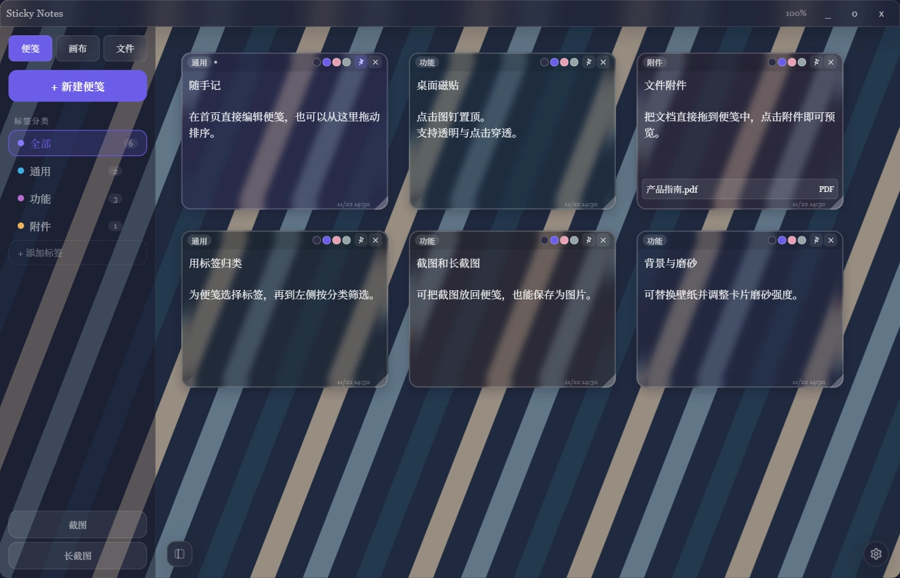
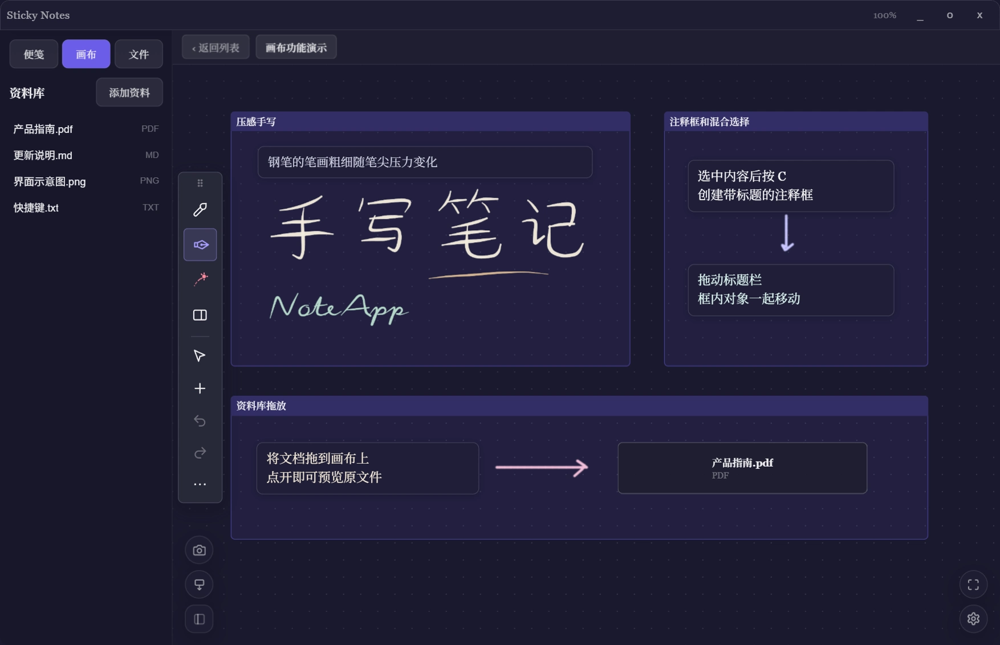
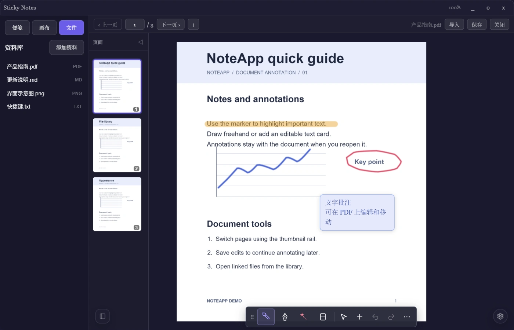
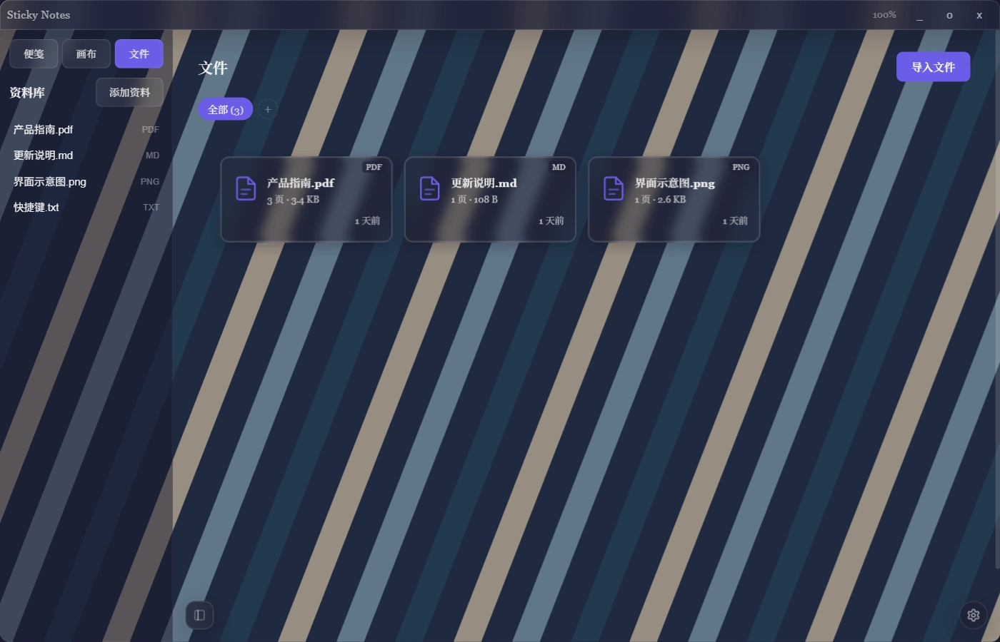
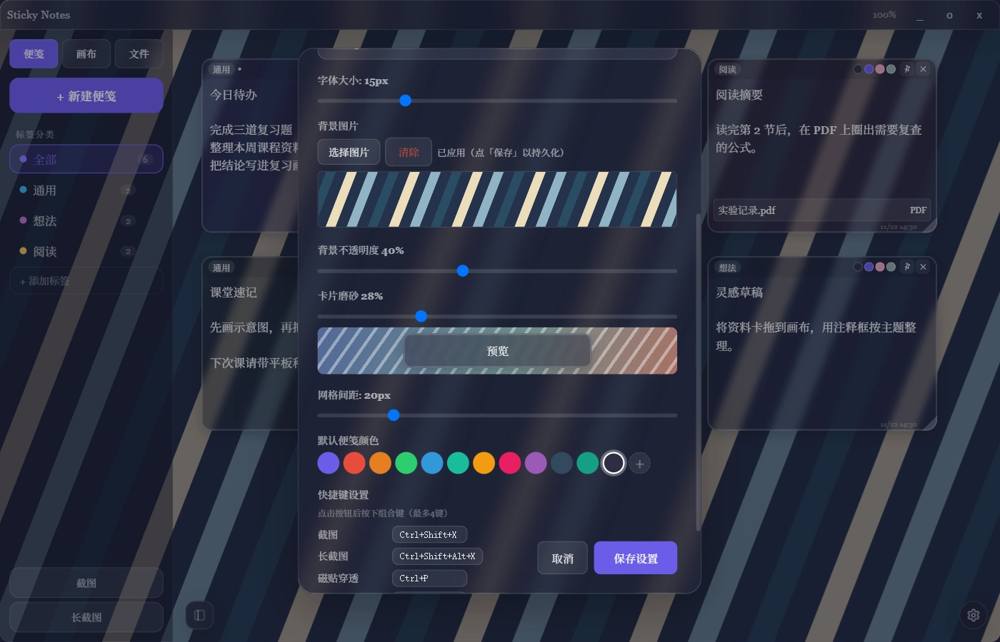

# NoteApp（Sticky Notes）

NoteApp 是一款 Windows 桌面应用，在同一个窗口里整理便笺、在无限画布上手写，以及逐页批注 PDF。画布和 PDF 共用支持压感的笔刷。

**[下载 Windows x64 便携版](https://github.com/BlackLnt-OxO/NoteApp/releases/latest)**，从 Release 的 Assets 下载 `.exe`，双击即可运行。首次启动时可选择数据存放位置。

### 便笺和桌面磁贴

按标签管理便笺，拖动排序，直接从资源管理器把图片或文档拖进便笺。点击图钉可以置顶为桌面磁贴，支持透明和鼠标穿透。首页也提供截图和长截图入口。



### 无限手写画布

在画布上放置笔迹、图形、文字、图片和文件链接。选择工具支持框选混合对象，按 **Shift** 加选、按 **Ctrl** 减选。选中内容后按 **C** 可以创建带标题的注释框，拖动标题会带走框内对象。手写工具栏可以沿编辑区边缘停靠，按 **N** 展开或收起。



### PDF 手写批注

用缩略图翻页，在原页上画线、涂色、圈重点或插入文字和图片。批注随对应源文件保存在应用数据目录，重新打开后可继续编辑。首次打开先显示可读页面，页面识别在后台进行。



### 文件和资料库

把 PDF、Word、Markdown、TXT 或常见图片放进资料库，之后可拖到画布和 PDF 批注页。外部文件也可直接拖到编辑区或便笺。资料行支持打开所在文件夹，移除资料库条目后仍保留磁盘原文件和已有批注。打开 Word 文档进行批注需要桌面版 Microsoft Word。



### 外观设置

可切换深浅主题，调整背景不透明度和整卡磨砂，或替换和清除内置斜纹壁纸。卡片边缘保留折射和彩边，并随附近光标移动。设置面板用磨砂玻璃，保存和取消按钮滚动时保持在右下角。



### 手写笔刷（PDF 标注与画布共用同一套引擎）

- **停笔规整与图形编辑**：画出直线、圆、椭圆、矩形或三角形后，默认保持按下不动约 0.5 秒，即可转换为等宽几何图形。抬笔后用控制点或参数面板修改长度、半径、宽高、角度及线宽；之后可用选择工具重新编辑。笔设置中的“停笔规整”可关闭或调整等待时间（0.5～3 秒），两处界面共用偏好。普通抬笔保留原笔迹；刚生成的图形可恢复手绘，保存重开后仍可调整图形参数。

- **可变宽度连续笔画**：压力驱动的连续 ribbon 渲染（“逐段四边形 + 逐点圆帽”union、单次 `fill('nonzero')`），无空洞、无接缝；弧长重采样保证墨迹均匀
- **三种笔**：标记笔（marker，半透明层叠）、钢笔（fountain，出墨量随速度）、铅笔（pencil，细腻纹理）；另有激光笔（写时重亮、松笔淡出）
- **压感曲线**：压力 → 线宽采用 Photoshop 式 gamma 曲线，线宽下限可低至发丝级 ≈0.15px；默认平滑 5%，平滑上限 20%
- **压感透明度**：随压力变化，并钳制在“滑条不透明度 ±10 个百分点”
- **边缘羽化**：可选柔和软边；可选关闭
- **其他**：橡皮（圆圈光标）、文本卡片可编辑 / 拖动 / 右键删除、PDF 画布缩略图栏等

## 技术栈

- **桌面壳**: Electron 33（frameless 窗口）
- **前端**: React 18 + TypeScript + Vite 5
- **状态管理**: Zustand 4
- **PDF 渲染**: pdfjs-dist
- **坐标体系**: 全局 `uiScale` UI 缩放（整窗 `transform: scale`），画布 / PDF 坐标系随缩放保持一致
- **测试**: Vitest + Testing Library + jsdom

> 早期模块还包含 Python 截图 / 长截图工具链（`electron/mss/`、`electron/longshot/` 等），随版本迭代已不是主功能，但目录保留。

## 快速开始

```bash
npm install
npm run dev
```

`npm run dev` 会并行启动 Vite（`http://localhost:5173`）与 Electron。首次运行会在系统数据目录中写入一份 `sticky-notes-config.json` 指针文件，dev 模式下默认把用户数据落到项目根的 `DataLocation/`。

## 常用命令

```bash
npm run dev          # 开发模式（Vite + Electron）
npm run build:engine # 冻结长截图 Python 引擎为独立 exe（仅打包机需要 Python+PyInstaller）
npm test             # 运行全部单测（vitest run）
npx vitest run       # 同上
npx tsc --noEmit     # TypeScript 类型检查
npm run build        # 发布构建（自动先 build:engine → vite build → electron-builder，portable exe 输出到 dist-electron/）
```

### 长截图 Python 引擎（打包说明）

主进程跑长截图用的是 [electron/longshot/capture_daemon.py](electron/longshot/capture_daemon.py)（stdin/stdout 换行 JSON 协议：`configure`/`tick`/`finish`/`shutdown`）。发布时由 [engine/cap-engine.spec](engine/cap-engine.spec) 用 PyInstaller 冻成独立 `cap-engine.exe`（内嵌 Python + cv2 + numpy + mss），随 electron-builder 打进 `resources/engine`——**端机无需安装 Python**。`npm run build` 已自动先跑 `npm run build:engine`。开发时 `npm run dev` 仍直接调本机 Python 跑源码（永远最新，不受引擎影响）；只有打包的 exe 走冻结引擎。

## 目录结构

```
NoteApp/
├── electron/                        # Electron 主进程（Node）
│   ├── main.js                      # 入口：窗口、IPC、数据目录（可配置 userData）、托盘、重载迁移
│   ├── preload.js                   # contextBridge → window.electronAPI
│   ├── floatingManager.js           # 便签磁贴（置顶 / 透明 frameless 窗）
│   ├── diagnostic.js                # 诊断日志
│   └── …                            # 截图 / 长截图 Python 辅助（mss、longshot、stitch*.py 等）
├── src/                             # React 前端
│   ├── main.tsx                     # 入口
│   ├── App.tsx                      # 根组件（notes / inkcanvas / pdf 视图切换）
│   ├── types.ts                     # Note、Tag、AppSettings、ViewMode 等类型
│   ├── utils.ts / themeColors.ts    # fs/fSn 字体缩放工具、画布 / 笔刷主题色
│   ├── global.d.ts                  # electronAPI 类型声明
│   ├── store/index.ts               # Zustand 全局状态（便签 CRUD + 设置 + 数据目录）
│   ├── styles/global.css            # 全局样式 + 设计 tokens
│   └── components/
│       ├── Sidebar.tsx              # 左栏（视图切换、新建、设置入口）
│       ├── NoteGrid.tsx / NoteCard.tsx / FlowGrid.tsx …   # 便签视图
│       ├── CreateNoteDialog.tsx / SettingsDialog.tsx / ColorPicker.tsx / ConfirmDialog.tsx
│       ├── ScreenshotTool.tsx / DiagnosticPanel.tsx / DataDirectoryPrompt.tsx
│       ├── InfiniteInkCanvas/       # 无限手写画布
│       │   ├── InfiniteInkCanvas.tsx / CanvasView.tsx / CanvasRenderer.ts
│       │   ├── InkTiles.ts          # 瓦片墨水层（3× 超采样烘焙）+ 实时预览层
│       │   ├── StrokeEngine.ts      # 笔画引擎（压感曲线、平滑）
│       │   ├── TextNode.tsx / TextObject.tsx / ImageObject.tsx
│       │   ├── Toolbar.tsx / ToolbarShell.tsx / useToolbarStore.ts / useCanvasStore.ts
│       │   ├── constants.ts / types.ts / useCanvasLibrary.ts
│       │   └── __tests__/           # StrokeEngine / 坐标 / store 测试
│       └── PdfAnnotation/           # PDF 标注
│           ├── PdfEngine.ts         # 纯数学几何、1€ 滤波平滑、压力 / 坐标换算
│           ├── PdfBrushRenderers.ts # marker / fountain / pencil 渲染（几何 + 像素测试）
│           ├── PdfCanvas.tsx / PdfView.tsx / PdfStore.ts / PdfTypes.ts
│           ├── PdfLoader.ts / PdfLibrary.ts / PdfPicker.ts / PdfSidebar.tsx / PdfToolbar.tsx
│           └── __tests__/           # 引擎 / 笔刷 / loader / library / store 测试
├── DataLocation/                    # 运行时用户数据（dev：项目根）——已 gitignore，不入库
├── pdf-annotations/                 # PDF 标注数据（dev：项目根）——已 gitignore，不入库
├── engine/                          # 长截图 Python 引擎（PyInstaller 冻结）
│   └── cap-engine.spec              # 冻结配置（产物 engine/dist、engine/build 已 gitignore）
├── package.json / package-lock.json
├── tsconfig.json / vite.config.ts / vitest.config.ts / .gitignore
```

## 手写与笔画擦除性能

源码分析、优化内容、性能基准和实机复测步骤见 [手写性能分析](docs/handwriting-performance.md)。

## 数据与隐私

- 便笺正文、窗口状态、设置等以 JSON 存入**用户数据目录**（`userData`），可在设置中更改数据目录
- dev 模式下 `userData` 指向项目根的 `DataLocation/`，`pdf-annotations/` 存标注层数据 —— 两者均已被 `.gitignore` 排除，**不进入版本库**
- 打包后 `userData` 落到系统默认的 `appData/sticky-notes`，同样与仓库隔离

## AI Generated
